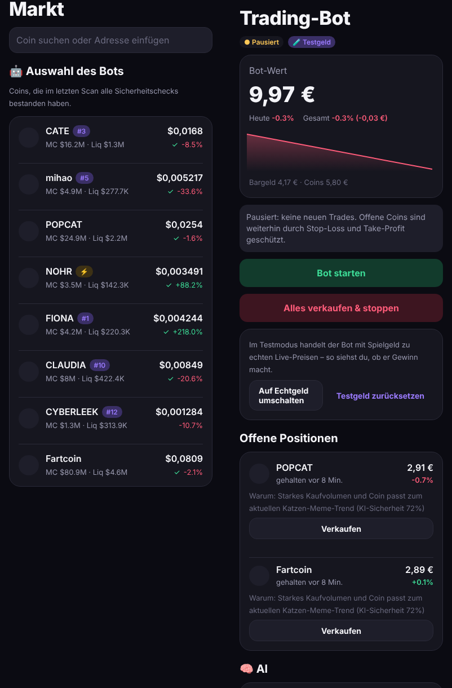

# Crypto Pilot

A personal iPhone app + 24/7 trading bot for Solana and meme coins.

- **Wallet** – connect your Phantom wallet, see your coins and their value in €.
- **Buy** – buy SOL/USDC with **card, PayPal, Apple Pay or bank transfer** through a licensed payment partner (MoonPay / Transak). The coins go straight to *your* Phantom wallet.
- **Market** – trending Solana coins, a safety check for every coin (RugCheck), an "Ask the AI" button, and swaps (SOL ⇄ meme coin) that you approve in Phantom.
- **Bot** – a trading bot that runs 24/7 on a free server with its own small wallet (e.g. €10). It finds trending coins, filters out scams, lets **Claude (AI)** pick trades using live market data and a daily web-research briefing, and protects the money with hard rules (stop-loss, take-profit, daily loss limit, kill switch). **Paper mode** tests it with fake money at real prices first.
- English + German.



```
 iPhone app (Expo)                 Bot server (Node.js, free cloud VM, 24/7)
 ┌─────────────────┐  HTTPS+token  ┌──────────────────────────────────────────┐
 │ Wallet / Buy    │──────────────▶│ API ─ Bot engine ─ Safety rules           │
 │ Market / Bot    │               │        │      │                           │
 │ Settings        │               │   Claude AI  Jupiter swaps ─ bot wallet   │
 └───────┬─────────┘               │        │                                  │
         │ deep links              │  DexScreener · GeckoTerminal · RugCheck   │
   Phantom app (signs YOUR trades) └──────────────────────────────────────────┘
```

---

## ⚠️ Read this first

- **No bot can guarantee profit.** Most meme-coin traders lose money. The AI is good at reading data, trends and news, but it cannot predict a coin's price. Treat the €10 as money you're OK to lose, and test in paper mode first.
- **Fees matter a lot with €10.** Card/PayPal providers charge roughly €2–4 per purchase and often have a €20–30 minimum. Each swap costs about €0.01 in network fees plus 0.1–1% slippage.
- **AI costs money too.** Each AI decision costs about $0.05 with Claude Opus 5.5 (the default), $0.025 with Sonnet 5.5, or $0.001 with Haiku 5.5. The bot only asks the AI when a coin looks promising (and hourly to review open coins), and stops at a daily budget (default $0.50, then it uses its rules). With €10 in the bot, Haiku is the sensible choice. You can switch in Settings.
- **The bot wallet is a "hot wallet"**: its key is stored on your server. Only keep small amounts in it. The bot can only ever withdraw to *your* Phantom address.
- This is a personal tool, not financial advice. Buying crypto through MoonPay/Transak means their identity check (KYC) and terms apply.

---

## Setup (about 1 hour, mostly clicking)

### Step 1 — Free 24/7 server (Oracle Cloud "Always Free")

1. Create an account at <https://www.oracle.com/cloud/free/>. They ask for a card for verification. Always Free resources cost nothing.
2. **Create a VM instance**: image **Ubuntu 24.04**, shape **VM.Standard.A1.Flex** (1 OCPU, 6 GB is plenty) or **VM.Standard.E2.1.Micro**. Download the SSH key they offer.
3. In the instance's **VCN → Security List**, add ingress rules for **TCP 80** and **TCP 443** from `0.0.0.0/0`.
4. Connect: `ssh -i your-key.key ubuntu@YOUR_SERVER_IP`, then:
   ```bash
   git clone https://github.com/aebellinaldo-maker/Claude.git
   cd Claude/bot
   bash deploy/setup-ubuntu.sh
   ```
   At the end it prints your **Server URL** (`https://1-2-3-4.sslip.io`) and **API token**. Keep both.
5. Add your keys (Step 2) to `Claude/bot/.env`, then `sudo systemctl restart crypto-bot`.
6. **Back up** `Claude/bot/data/bot-wallet.json` (the bot's wallet key) somewhere safe.

> Alternative: Google Cloud's free e2-micro VM works the same way. Or just run `npm install && npm run dev` in `bot/` on your own PC (then the bot only trades while the PC is on).

### Step 2 — Keys

| Key | Needed? | Where |
|---|---|---|
| `ANTHROPIC_API_KEY` | For AI decisions (without it the bot uses rules) | <https://console.anthropic.com> → API Keys (needs a few $ of prepaid credit) |
| `RPC_URL` | Recommended (faster, more reliable trades) | <https://www.helius.dev> free plan → mainnet RPC URL |
| `MOONPAY_PUBLISHABLE_KEY` + `MOONPAY_SECRET_KEY` | Optional — pre-fills your wallet address in the buy page | <https://dashboard.moonpay.com> |
| `TRANSAK_API_KEY` | Optional — second payment provider | <https://dashboard.transak.com> |

Without MoonPay/Transak keys, **Buy** still works: the app copies your wallet address and opens MoonPay's website (card, PayPal, Apple Pay). The Phantom app also has its own *Buy* button.

### Step 3 — App on your iPhone

You need a computer (Mac/Windows/Linux) with [Node.js](https://nodejs.org) once.

1. Install **Expo Go** and **Phantom** from the App Store.
2. On your computer:
   ```bash
   cd Claude/app
   npm install
   npx expo start --tunnel
   ```
3. Scan the QR code with the iPhone camera → it opens in Expo Go.

Expo Go loads the app from your computer, so keep `npx expo start` running while you use it. For a real standalone app that works without your computer, you need an Apple Developer account ($99/year): run `npx eas-cli build --platform ios --profile production` and then `npx eas-cli submit --platform ios`, and install it from **TestFlight**. Change `ios.bundleIdentifier` in `app/app.json` to your own first, e.g. `com.yourname.cryptopilot`.

### Step 4 — First run

1. **Settings** → enter the Server URL + API token → *Save & test*. Choose English/Deutsch.
2. **Wallet** → *Connect Phantom* → approve in Phantom. This wallet becomes the bot's only withdrawal address.
3. **Bot** → *Start bot* in **paper mode**. Let it run for a few days and watch *Activity* and *Trade history*.
4. Happy with the results? **Bot → Pause → Switch to real money**, then **Wallet → Fund bot** to send e.g. 0.15 SOL (≈ €10) from Phantom → *Start bot*.
5. Want out? **Sell all & stop**, then **Fund bot → Withdraw everything to Phantom**.

---

## How the bot decides

Every 10 minutes (scan) and every 30 seconds (protection):

1. **Discover** — DexScreener *boosted* tokens (projects paying for promotion: a marketing/hype signal), new DexScreener profiles, GeckoTerminal trending pools, and a watchlist of big Solana memes (BONK, WIF, POPCAT, FARTCOIN, PENGU, TRUMP, BOME, JUP).
2. **Hard filters** (can't be overridden by the AI) — liquidity ≥ $50k, 24h volume ≥ $100k, coin age ≥ 24h, market cap ≥ $250k, not already +300% in 24h, not dumping, not 3× more sellers than buyers.
3. **Rug-pull check** — RugCheck.xyz: rejects mint/freeze authority, "danger" risks, high risk scores.
4. **Scoring** — momentum, buy pressure, volume acceleration, liquidity, hype (boosts, trending rank, socials).
5. **AI decision** — Claude gets the top coins, your open positions, recent wins/losses (to learn from them) and a research briefing (it searches the web for market mood, hot narratives, scams). It answers with buy/skip/sell, confidence and a plain-language reason (in your language). Only coins that passed the filters can be bought.
6. **Execution** — swaps through Jupiter (best price across Solana DEXes), with price-impact limits. Paper mode uses the exact same Jupiter quotes.
7. **Protection (every 30 s)** — stop-loss, take-profit (sells half), trailing stop, max hold time, instant exit if liquidity collapses (rug pull), daily loss limit, kill switch.

Defaults (all changeable in the app → Settings):

| Setting | Default |
|---|---|
| Stop-loss | −15 % |
| Take-profit | +40 % (sell 50 %, the rest runs with a 20 % trailing stop) |
| Max coins at once | 3, max 40 % of the money per coin |
| Max hold time | 24 h (if not up ≥10 %) |
| Daily loss limit | −20 % → no new buys until tomorrow |
| Kill switch | −50 % from the best value → sell everything and stop |
| AI | Claude Opus 5.5, max $0.50/day, decides at most every 20 min, min. confidence 60 % |

---

## Project layout

```
bot/    Bot server (TypeScript, Node 20+)
  src/market/   DexScreener, GeckoTerminal, RugCheck, Jupiter, prices
  src/risk/     safety filters, scoring, exit rules & circuit breakers
  src/ai/       Claude decisions, web-research briefing, "ask the AI"
  src/engine/   bot loop, paper + real executors
  src/chain/    Solana wallet, balances, sending transactions
  src/api/      HTTP API for the app, card/PayPal on-ramp links
  deploy/       Ubuntu setup script (systemd + Caddy HTTPS)
app/    iPhone app (Expo SDK 58, expo-router, native iOS tabs)
  src/app/      screens (Wallet, Market, Bot, Settings, coin, buy, bot wallet, trades)
  src/lib/      Phantom deep links, API client, translations
```

Useful commands (in `bot/`): `npm test` (safety-rule tests), `npm run scan` (show what the bot would consider right now, no trading), `npm run dev` (run locally).

## Status / what still needs a real-world check

Tested here: all bot logic and safety rules (unit tests); live market data from DexScreener, Jupiter, RugCheck and CoinGecko; paper trades with real Jupiter quotes (buy → partial sell → full sell); every API endpoint; the app's TypeScript and its iOS bundle build; and every screen rendered at iPhone size.

**Not testable from my build environment. Check these yourself with small amounts:**
- the Phantom connect/sign flow on a real iPhone;
- real-money swaps from the bot wallet;
- live Claude API calls (needs your key);
- MoonPay URL signing with real keys;
- the setup script on a real Oracle VM.
